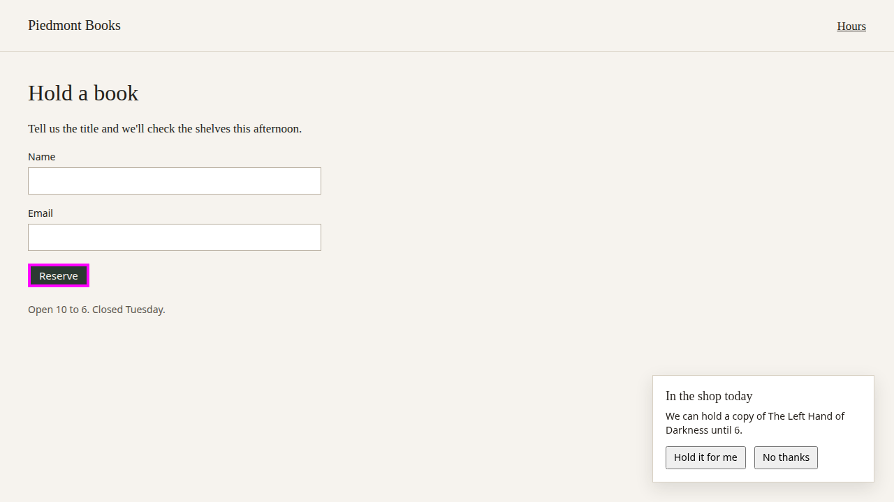
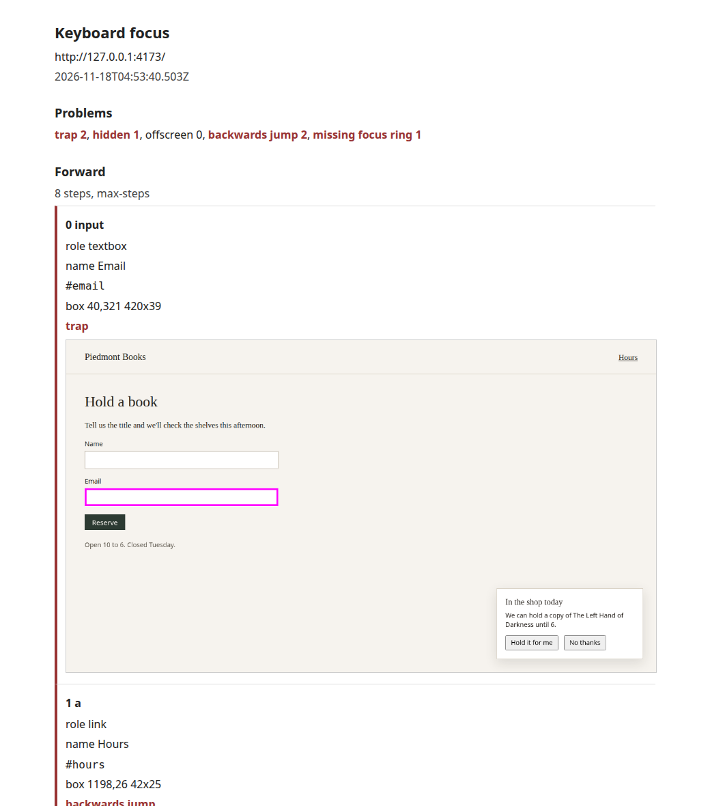

# keyboard-focus-audit

I want one command that opens a url, walks it with Tab and Shift+Tab, and writes down the focus order.

```
keyboard-focus-audit https://example.com
```

## Options

`--max-steps` caps how far each walk goes. The default is 50. `--out` is the folder I write to, `focus-out` if I leave it out. `--viewport` is the width and height, written as `1280x720`. `--no-ring-check` skips the focus ring check, which is the slow part. `--no-shots` skips the screenshots. `--report` is the html file. It lands next to the record unless I pass a path. `--no-report` skips that file.

## What it looks for

A trap is a walk that loops, or that lands on the same stop twice. A hidden stop is not visible, or has no box. That covers `display: none`, `visibility: hidden`, `opacity: 0`, and anything with no size. An offscreen stop is visible but sits outside the viewport. A backwards jump is a forward Tab that moves up the page, or to the left on the same line. A missing ring is a forward stop whose pixels do not change when I blur it. I compare outline, shadow, border, and colors, then diff a small screenshot around the element. A style change that leaves the pixels alone does not count.

## Exit codes

I exit 0 when nothing is wrong, 2 when any of those turn up, and 1 when the arguments are bad or the run fails.

## What it writes

The command prints a compact table, then a one-line count of each problem and the paths it wrote.

For every step I save a screenshot under `steps/`, `forward-001.png` and so on, with a bright box around the focused element. The box comes off before the next tab so it does not change focus or the ring check. `focus-record.json` has the tool version, the url, the viewport, the time, both walks, the issues, and the counts. `focus-report.html` is the same walk as one page: the url, the time, the counts, then each step with its shot and whatever is wrong with it. The css and the shots are in the file, so it opens on its own. With `--no-shots` the page is still the full list, just without the pictures.

## Demo

`demo/` is a small shop page. The email field has `tabindex="1"`, so Tab hits it first and then jumps up to the hours link. Reserve has no focus style. A staff link is left at `opacity: 0`. An open dialog keeps Tab cycling between its two buttons.

```
npm run demo
node dist/keyboard-focus-audit.js http://127.0.0.1:4173/ --max-steps 8
```

That run is supposed to exit 2.

GitHub Actions does the same on every push to main, and when I start the workflow by hand. It installs Chromium, builds, runs the tests, serves the demo, and checks that the audit exited 2 with a trap, a hidden stop, a backwards jump, and a missing ring. The report, the record, and the shots are uploaded as an artifact.





```
npm install
npx playwright install chromium
npm test
npm run build
node dist/keyboard-focus-audit.js https://example.com
```
